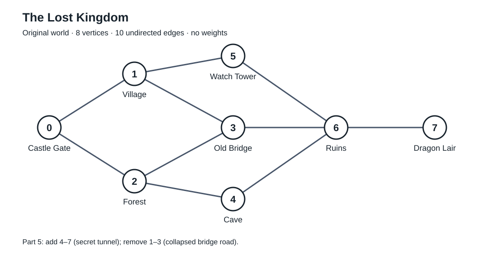

# The Lost Kingdom Graph Challenge Answers

## Part 1 Model the World on Paper



Draw the eight locations as vertices and add the following ten edges without arrows:

**0–1, 0–2, 1–3, 1–5, 2–3, 2–4, 3–6, 5–6, 4–6, 6–7.**

| ID | Location | Original neighbours |
|---|---|---|
| 0 | Castle Gate | Village, Forest |
| 1 | Village | Castle Gate, Old Bridge, Watch Tower |
| 2 | Forest | Castle Gate, Old Bridge, Cave |
| 3 | Old Bridge | Village, Forest, Ruins |
| 4 | Cave | Forest, Ruins |
| 5 | Watch Tower | Village, Ruins |
| 6 | Ruins | Old Bridge, Watch Tower, Cave, Dragon Lair |
| 7 | Dragon Lair | Ruins |

**Is the graph directed or undirected?**

The graph is undirected because each connection allows travel in both directions.

**Is the graph weighted or unweighted?**

The original graph is unweighted because no travel costs, distances or times are given for its edges.

**How many vertices and edges are there?**

There are 8 vertices and 10 edges. Each two-way connection counts as one edge.

**What are the neighbours of Forest?**

Forest is directly connected to Castle Gate, Old Bridge and Cave.

**What is the degree of Ruins?**

The degree of Ruins is 4 because it is connected to Old Bridge, Watch Tower, Cave and Dragon Lair.

**Give one valid path from Castle Gate to Dragon Lair.**

Castle Gate → Village → Old Bridge → Ruins → Dragon Lair.

## Part 2 Choose a Representation

**Is this graph sparse or dense?**

This graph is sparse. It has 10 edges out of a possible 28 in a simple undirected graph with 8 vertices, so most pairs of locations are not directly connected.

**Which representation would you choose?**

I would choose an adjacency list.

**Why does that representation suit this graph?**

An adjacency list stores only the actual neighbours of each location. It suits a sparse graph and makes it convenient to list the places directly reachable from a location. Its memory use is O(V + E), compared with O(V²) for an adjacency matrix.

**What operation will your program perform most often?**

The program will frequently look up and display the neighbours of a location.

## Part 3 Build the Graph

**What does addUndirectedEdge do?**

It adds b to the neighbour list of a and adds a to the neighbour list of b. Both updates are needed because the connection is undirected.

### Task 3A Missing Connections

```cpp
addUndirectedEdge(graph, 2, 3); // Forest-Bridge
addUndirectedEdge(graph, 2, 4); // Forest-Cave
addUndirectedEdge(graph, 3, 6); // Bridge-Ruins
addUndirectedEdge(graph, 5, 6); // Watch Tower-Ruins
addUndirectedEdge(graph, 4, 6); // Cave-Ruins
addUndirectedEdge(graph, 6, 7); // Ruins-Dragon Lair
```

### Task 3B Display Every Connection

**What does the outer loop do?**

The outer loop visits every location and prints its name.

**What does the inner loop do?**

The inner loop visits the neighbours of the current location and prints their names.

**Why does the inner loop use graph[i]?**

The vector graph[i] contains the IDs of the neighbours of location i. The expression names[neighbour] converts each neighbour ID into its location name.

**Required checks**

Castle Gate displays Village and Forest. Ruins displays Old Bridge, Watch Tower, Cave and Dragon Lair. Each undirected edge appears in two neighbour lists, one for each endpoint.

## Part 4 Query One Location

The three missing expressions, in order, are:

```cpp
static_cast<int>(graph.size())
names[id]
graph[id]
```

The completed function and user input are included in main.cpp. The cast converts the size to int for comparison with the integer ID. Valid IDs are 0 to 7.

**Query checks for the original world**

| Input | Expected result |
|---|---|
| 7 | Selected location: Dragon Lair. Directly reachable: Ruins. |
| 6 | Selected location: Ruins. Directly reachable: Old Bridge, Watch Tower, Cave, Dragon Lair. |
| 8 or -1 | Invalid location ID. |

**Why does Dragon Lair initially have only one direct neighbour?**

The original specification contains only one edge connected to Dragon Lair: Ruins–Dragon Lair. Other locations require travelling through intermediate vertices.

## Part 5 Modify the World

### Task 5A Add the Secret Tunnel

```cpp
addUndirectedEdge(graph, 4, 7); // Cave-Dragon Lair
```

### Task 5B Remove the Collapsed Bridge Connection

The two missing values in removeUndirectedEdge are **b** and **a**, in that order:

```cpp
graph[a].erase(
    remove(graph[a].begin(), graph[a].end(), b),
    graph[a].end()
);
graph[b].erase(
    remove(graph[b].begin(), graph[b].end(), a),
    graph[b].end()
);
```

Call the function with:

```cpp
removeUndirectedEdge(graph, 1, 3);
```

**Which two neighbour lists change when the Village–Old Bridge connection is removed?**

Village loses Old Bridge, and Old Bridge loses Village. Village then has Castle Gate and Watch Tower as neighbours. Old Bridge then has Forest and Ruins as neighbours.

**Which lists change when the tunnel is added?**

Cave gains Dragon Lair, and Dragon Lair gains Cave. Across both modifications, four neighbour lists change in total.

**Why must an undirected edge change update both endpoints?**

An undirected edge is stored in the neighbour lists of both endpoints. Updating only one list would make the two lists disagree about whether the road exists in both directions.

**Neighbour lists after both changes**

| Location | Neighbours |
|---|---|
| Castle Gate | Village, Forest |
| Village | Castle Gate, Watch Tower |
| Forest | Castle Gate, Old Bridge, Cave |
| Old Bridge | Forest, Ruins |
| Cave | Forest, Ruins, Dragon Lair |
| Watch Tower | Village, Ruins |
| Ruins | Old Bridge, Watch Tower, Cave, Dragon Lair |
| Dragon Lair | Ruins, Cave |

There are still 8 vertices and 10 edges because one edge was added and one was removed. The Old Bridge vertex remains in the graph.

## Part 6 Add Weights on Paper

Use the following weights for the modified graph. The five required weights are preserved, and the other values are reasonable choices. For this example, each weight represents travel time in minutes.

| Edge | Weight | Value |
|---|---|---|
| Castle Gate–Village | 2 | Given |
| Castle Gate–Forest | 4 | Given |
| Village–Watch Tower | 3 | Given |
| Forest–Old Bridge | 3 | Chosen |
| Forest–Cave | 2 | Given |
| Old Bridge–Ruins | 4 | Chosen |
| Watch Tower–Ruins | 3 | Chosen |
| Cave–Ruins | 2 | Chosen |
| Ruins–Dragon Lair | 5 | Given |
| Cave–Dragon Lair | 4 | Chosen |

If weights are added to a separate drawing of the original graph, omit Cave–Dragon Lair and use a weight of 2 for Village–Old Bridge instead.

**What could a weight represent in a game? Give two possibilities.**

A weight could represent travel time in minutes or the stamina cost of travelling along a road.

**Does adding weights change the vertices or connections?**

No. Adding weights only assigns values to existing edges. The vertices and connections stay the same. The road changes in Part 5 are separate operations.

**Why might weights matter in pathfinding?**

Weights allow a pathfinding algorithm to compare the total cost of different routes. A route with fewer edges may still take more time or stamina than a route with more edges.

## Part 7 Final Reasoning Challenge

**Why is a graph better than a simple array for this world?**

A simple array of names stores the locations but does not describe their connections. A graph models the roads, branches and cycles between locations. Arrays or vectors can still be used to implement the graph.

**Why is this graph sparse?**

It has only 10 of the 28 possible undirected edges, and each location has relatively few neighbours.

**What would be easy with a matrix?**

Checking whether two specific locations are directly connected would be easy. Accessing matrix[a][b] takes O(1) time.

**What would be convenient with a list?**

Listing the actual neighbours of a location would be convenient. It takes O(degree(v)) time and avoids checking every possible location.

**If roads became one-way, what type of graph would we have?**

We would have a directed graph. An edge from a to b would not automatically imply an edge from b to a.

**What algorithm might we later use to explore all reachable places?**

We could use breadth-first search (BFS) or depth-first search (DFS). A visited array would prevent repeatedly processing the same locations in cycles.

## Optional Extension Example

This is a proposed extension beyond the required implementation.

Add Mountain Camp with ID 8 and Hidden Lake with ID 9. Add the connections Watch Tower–Mountain Camp (5–8), Mountain Camp–Hidden Lake (8–9) and Hidden Lake–Cave (9–4).

After adding both names and increasing the graph to 10 vertices, query ID 8. Its neighbours should be Watch Tower and Hidden Lake. The modified world would then have 10 vertices and 13 edges out of a possible 45, so an adjacency list would still be suitable.
