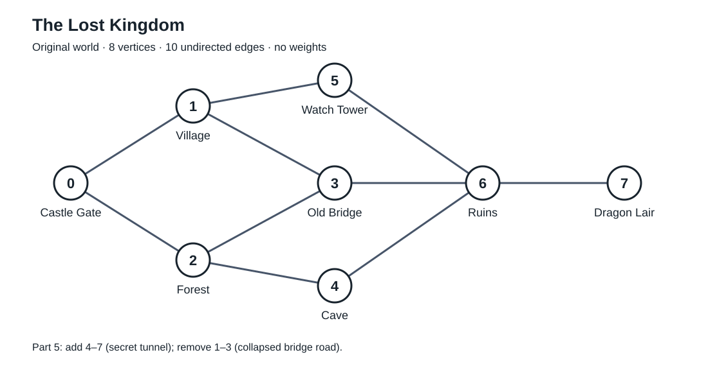

# Week 08 Lab 02 — решение и объяснение

Здесь две основные работы: сначала изобразить игровой мир графом на бумаге и объяснить его свойства, затем написать C++-программу. Готовый код находится в `main.cpp`, схема для перерисовки — в `graph.svg`. Взвешивание в части 6 выполняется только на бумаге. Алгоритм поиска пути пока не требуется.

## 1. Что нарисовать на бумаге



Нарисуй восемь кружков с номерами и названиями из таблицы. Соедини их линиями без стрелок. Расположение кружков произвольное; важны сами соединения.

| ID | Локация | Соседи в исходном графе |
|---|---|---|
| 0 | Castle Gate | 1, 2 |
| 1 | Village | 0, 3, 5 |
| 2 | Forest | 0, 3, 4 |
| 3 | Old Bridge | 1, 2, 6 |
| 4 | Cave | 2, 6 |
| 5 | Watch Tower | 1, 6 |
| 6 | Ruins | 3, 5, 4, 7 |
| 7 | Dragon Lair | 6 |

Все десять линий: **0–1, 0–2, 1–3, 1–5, 2–3, 2–4, 3–6, 5–6, 4–6, 6–7**. Каждая пара — одна дорога, хотя в таблице соседей она записана с обеих сторон.

Ответы для первой части:

- **Неориентированный (undirected):** по дороге можно идти в обе стороны. Направления в условии не указаны; дальнейший код явно использует двусторонние связи.
- **Невзвешенный (unweighted):** в исходном условии не заданы стоимость, время или длина дорог.
- **Количество вершин:** 8. **Количество рёбер:** 10.
- **Соседи Forest:** Castle Gate, Old Bridge, Cave — номера 0, 3, 4.
- **Степень Ruins:** 4. Степень вершины — количество рёбер, которые к ней подходят.
- **Один допустимый путь:** Castle Gate → Village → Old Bridge → Ruins → Dragon Lair, то есть 0 → 1 → 3 → 6 → 7. Задание просит любой допустимый путь.

Проверка: сумма степеней равна 2 + 3 + 3 + 3 + 2 + 2 + 4 + 1 = 20. Каждое ребро посчитано у двух концов, поэтому рёбер 20 / 2 = 10.

## 2. Как представить граф в программе

**Граф разреженный (sparse).** У простого неориентированного графа из 8 вершин без петель может быть максимум 8 × 7 / 2 = 28 рёбер. Здесь их 10, и у каждой локации сравнительно немного соседей.

**Выбор — список смежности (adjacency list).** Для каждой локации храним список только её непосредственных соседей. Это удобно, когда нужно часто выводить места, куда можно попасть за один переход, или обходить соседей при исследовании мира.

В C++ это `vector<vector<int>> graph`: внешний вектор содержит локации, внутренний — номера соседей конкретной локации. Например, `graph[2]` содержит `{0, 3, 4}`. Названия хранятся отдельно: `names[2]` — строка `"Forest"`.

Список занимает O(V + E) памяти; матрица — O(V²). Матрица 8 × 8 тоже подошла бы для такого маленького мира, но список соответствует операциям задания и удобен при росте разреженного графа.

## 3. Построение графа и вывод

Шесть пропущенных вызовов в Task 3A:

```cpp
addUndirectedEdge(graph, 2, 3); // Forest-Bridge
addUndirectedEdge(graph, 2, 4); // Forest-Cave
addUndirectedEdge(graph, 3, 6); // Bridge-Ruins
addUndirectedEdge(graph, 5, 6); // Watch Tower-Ruins
addUndirectedEdge(graph, 4, 6); // Cave-Ruins
addUndirectedEdge(graph, 6, 7); // Ruins-Dragon Lair
```

В `addUndirectedEdge(graph, a, b)` строка `graph[a].push_back(b)` добавляет b к соседям a, а `graph[b].push_back(a)` добавляет обратную связь. `&` означает передачу по ссылке: функция меняет исходный граф.

В `displayAllConnections` внешний цикл перебирает все локации. Внутренний цикл перебирает `graph[i]`, потому что это список соседей текущей локации i. Переменная `neighbour` содержит номер соседа, а `names[neighbour]` даёт его название.

`const vector<...>&` позволяет читать исходный вектор без копирования и запрещает изменять его через этот параметр. `static_cast<int>(graph.size())` приводит размер к типу `int`, чтобы сравнивать его с целочисленным ID без предупреждения компилятора о разных знаковых типах.

При выводе каждая дорога видна дважды: например, Village указан у Castle Gate, а Castle Gate — у Village. Для неориентированного графа это правильно.

## 4. Запрос одной локации

Три пропуска в функции заполняются так:

1. `static_cast<int>(graph.size())` — верхняя граница ID; в примере задания можно написать `graph.size()`.
2. `names[id]` — название выбранной локации.
3. `graph[id]` — её список соседей.

Сначала проверяем `id < 0` или `id >= graph.size()`, затем обращаемся к элементам. Для восьми локаций разрешены только ID от 0 до 7 включительно.

Программа спрашивает ID для **исходного** мира. Запусти её несколько раз для проверки:

| Ввод | Ожидаемый результат первого запроса |
|---|---|
| 7 | Dragon Lair → Ruins |
| 6 | Ruins → Old Bridge, Watch Tower, Cave, Dragon Lair |
| 8 или -1 | Invalid location ID. |
| abc | Сообщение, что нужно ввести целое число |

У Dragon Lair изначально только один прямой сосед, потому что в исходном списке есть только одна дорога к нему: Ruins–Dragon Lair. Остальные места доступны через промежуточные локации и прямыми соседями не являются.

## 5. Изменение мира

Добавляем туннель `addUndirectedEdge(graph, 4, 7);` и удаляем дорогу `removeUndirectedEdge(graph, 1, 3);`. Удаляется только связь Village–Old Bridge; вершина Old Bridge и другие её дороги остаются.

В функции удаления первый пропуск — **b**, второй — **a**. Из списка a удаляется b, а из списка b удаляется a.

`std::remove` сдвигает сохраняемые элементы к началу вектора и возвращает новый логический конец. Сам размер вектора он не уменьшает. Затем `erase` удаляет оставшийся хвост. Это называется erase-remove pattern; нужен заголовок `<algorithm>`.

После обеих изменений:

| Локация | Соседи до | Соседи после |
|---|---|---|
| Village (1) | 0, 3, 5 | 0, 5 |
| Old Bridge (3) | 1, 2, 6 | 2, 6 |
| Cave (4) | 2, 6 | 2, 6, 7 |
| Dragon Lair (7) | 6 | 6, 4 |

В вопросе «which two neighbour lists changed» для **удаления дороги** ответ: Village и Old Bridge. Для **добавления туннеля**: Cave и Dragon Lair. После обеих операций изменены четыре списка. Остальные списки не изменились. Вершин по-прежнему 8, рёбер снова 10: добавили одно и удалили одно.

Оба конца обновляются потому, что связь двусторонняя. Если удалить только одну запись, программа будет считать, что из Village нельзя пройти к мосту, а обратно всё ещё можно.

На бумажной схеме зачеркни 1–3 и дорисуй 4–7. Лучше сохранить исходный рисунок и рядом сделать изменённый: так видны оба состояния.

## 6. Веса на бумаге

Вес — число возле дороги. Пять значений заданы преподавателем; остальные ниже выбраны как допустимый пример. Для исходного рисунка используй первые десять строк; для изменённого убери 1–3 и добавь 4–7.

| Дорога | Вес | Откуда значение |
|---|---|---|
| Castle Gate–Village (0–1) | 2 | Задано |
| Castle Gate–Forest (0–2) | 4 | Задано |
| Village–Old Bridge (1–3) | 2 | Выбрано; только исходный граф |
| Village–Watch Tower (1–5) | 3 | Задано |
| Forest–Old Bridge (2–3) | 3 | Выбрано |
| Forest–Cave (2–4) | 2 | Задано |
| Old Bridge–Ruins (3–6) | 4 | Выбрано |
| Watch Tower–Ruins (5–6) | 3 | Выбрано |
| Cave–Ruins (4–6) | 2 | Выбрано |
| Ruins–Dragon Lair (6–7) | 5 | Задано |
| Cave–Dragon Lair (4–7) | 4 | Выбрано; только изменённый граф |

Два возможных смысла веса: **время перехода в минутах** или **расход выносливости в очках**. На одном рисунке выбери один смысл для всех дорог.

Добавление весов само по себе не меняет вершины и соединения: к существующим рёбрам добавляются числа. Изменения дорог в части 5 — отдельная операция.

Веса понадобятся для выбора маршрута с минимальной суммой затрат. Самый короткий по числу переходов путь может оказаться дорогим по времени или выносливости. В этой работе веса в C++ добавлять не требуется.

## 7. Ответы на итоговые вопросы

**Почему граф лучше простого массива?** Массив названий хранит локации, но сам по себе не описывает дороги. Граф явно показывает, какие места соединены, включая развилки и циклы. Сам граф при этом можно хранить с помощью массивов или векторов.

**Почему граф разреженный?** В нём 10 рёбер из возможных 28, и у большинства локаций лишь несколько соседей.

**Что удобно делать с матрицей?** Проверять наличие конкретной дороги a–b: достаточно посмотреть `matrix[a][b]`, то есть O(1).

**Что удобно делать со списком?** Перебирать только реальных соседей выбранной локации, то есть O(degree(v)), и хранить разреженный мир без ячеек для всех отсутствующих дорог.

**Если дороги станут односторонними?** Получится ориентированный граф (directed graph). Для дороги a → b нужно добавлять b только в список a; обратная связь добавляется отдельно, если она разрешена.

**Как позже исследовать все достижимые места?** Обходом в ширину (BFS, с очередью) или обходом в глубину (DFS, со стеком или рекурсией). Нужен массив посещённых вершин, чтобы не зациклиться. Для этого вопроса достаточно назвать и объяснить алгоритм.

## Как собрать и запустить

В PowerShell из папки проекта:

```powershell
g++ -std=c++17 -Wall -Wextra -pedantic main.cpp -o game_graph.exe
.\game_graph.exe
```

Если `g++` не находится через PATH, в этой среде он доступен по адресу:

```powershell
& 'C:\msys64\ucrt64\bin\g++.exe' -std=c++17 -Wall -Wextra -pedantic main.cpp -o game_graph.exe
.\game_graph.exe
```

Сначала программа выводит исходный мир и спрашивает один ID. Затем применяет обе правки, выводит изменённый мир и повторно показывает соседей Dragon Lair, чтобы был виден новый туннель. Сообщения в консоли написаны по-английски, как в задании.

## Необязательное расширение

Основной `main.cpp` выполняет обязательные части. Extension в документе предлагается только тем, кто закончил раньше. Пример расширения после изменений мира: добавить 8 — Mountain Camp и 9 — Hidden Lake, а затем дороги 5–8, 8–9, 9–4. Понадобятся два новых названия и граф на 10 вершин; запрос ID 8 должен показать Watch Tower и Hidden Lake. Будет 13 рёбер из возможных 45, поэтому список смежности по-прежнему подходит.

## Что показать преподавателю

1. Исходный рисунок с 8 вершинами и 10 рёбрами, ответы частей 1 и 2.
2. Работающий вывод всех соединений и запросы ID 7, 6 и неверного ID.
3. Изменённую схему и вывод программы после добавления 4–7 и удаления 1–3.
4. Веса на бумаге и объяснения из частей 6 и 7.
